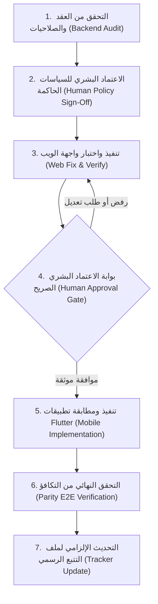

# AAFIYA V1 — خطة إصلاح اختلالات التكافؤ بين Web وFlutter (النسخة المصححة)
## Architectural Remediation Plan & Lifecycle Governance

**الوضع التشغيلي الإلزامي:**
`READ-ONLY SOURCE INSPECTION / ZERO CODE MUTATION / NO TEST EXECUTION / NO DATABASE ACCESS / NO HTTP REQUESTS / NO DEPLOYMENT / PLANNING ONLY`

---

## 1. الغرض والنطاق والقيود الحاكمة (Purpose, Scope & Constraints)

### 1.1 الغرض (Purpose)
تهدف هذه الخطة الهندسية المصححة إلى وضع خارطة طريق دقيقة، مبنية على التحقق المباشر من الكود المصدري، لمعالجة الاختلالات الوظيفية والسلوكية والصلاحيات بين منصة الويب (`src/`) وتطبيقات الهواتف الذكية المبنية بإطار عمل Flutter (`mobile/`) في مشروع AAFIYA V1، مع تحديد البوابات التشغيلية الصارمة وقواعد الحوكمة لضمان عدم حدوث أي تغيير في السياسات أو تجاوز للصلاحيات أو طفرات برمجية دون إذن بشري صريح وموثق.

### 1.2 نطاق العمل (Scope)
يشمل نطاق التخطيط **18 وظيفة محددة بدقة** موزعة على الأدوار الخمسة الحاكمة في النظام:
1. **المريض المسجل (Patient):** الوظائف `P-01` إلى `P-05`.
2. **الطبيب (Doctor):** الوظائف `D-01` إلى `D-05`.
3. **مدير العيادة (Clinic Director):** الوظائف `CD-01` و `CD-02`.
4. **مساعد العيادة (Doctor Assistant):** الوظائف `DA-01` إلى `DA-05`.
5. **مركز الحجز المؤسسي (Booking Center):** الوظيفة `BC-01`.

### 1.3 القيود التشغيلية الصارمة (Strict Constraints)
- **Zero Mutation:** لا يُسمح بتعديل أو إضافة أو حذف أي ملف برمجي، أو إنشاء migrations، أو كتابة واجهات، أو تشغيل اختبارات، أو إجراء اتصالات شبكية أثناء مرحلة إعداد هذه الخطة.
- **Source-Code Backed Only:** لا يُعتمد أي استنتاج بناءً على وثائق قديمة أو تعليقات نصية أو تشابه في المسميات؛ يجب أن يستند كل تصنيف إلى الكود المصدري الفعلي مع أرقام الأسطر والمسارات الدقيقة.
- **Distinction of Statuses:** الفصل الواضح بين الحقيقة البرمجية المثبتة، والتوصية المقترحة، والقرار البشري المطلوب، والسياسة المعتمدة، وتفويض التنفيذ.
- **Tracker Integrity:** لا يُعدَّل ملف التتبع الرسمي أثناء إعداد الخطة، ولكن تُرسى قواعد إلزامية لتحديثه خطوة بخطوة عند الشروع في التنفيذ اللاحق.

---

## 2. ملخص الخطة الأصلية والتحفظات الفنية المصححة (Corrections & Revisions)

بناءً على المراجعة النقدية العميقة للتقرير الأولي ومسودة الخطة السابقة، تم رصد ومعالجة التحفظات الفنية والمنهجية التالية:

### 2.1 تصحيح أولوية إلغاء الموعد للمريض (P-01 Priority Downgrade)
- **التحفظ السابق:** تم تصنيف الخلل بأولوية حرجة قصوى `P0 — Critical`.
- **التصحيح المعتمد:** خفض الأولوية إلى **`P1 — High`**. زر الإلغاء على الويب هو زر شكلي يستدعي تنبيهاً (`alert()`) ولا يرسل طلباً، وتطبيق الجوال يفتقر للزر. هذا الخلل يمثل نقصاً تشغيلياً أساسياً (Core Operational Gap) يعيق المريض عن الإلغاء الذاتي، ولكنه **لا يخرق الصلاحيات**، ولا يسرب بيانات صحية، ولا يسمح بعمليات غير مصرح بها، لأن سياسة الخلفية (`BookingService.php`) مؤمنة بأقفال صلبة وترفض الإلغاء غير المصرح به.

### 2.2 فك الارتباط الاصطناعي بين بطاقة الزيارة QR والإلغاء (Decoupling P-02 from P-01)
- **التحفظ السابق:** افترضت الخطة السابقة وجود تبعية بين إصلاح بطاقة الزيارة الرقمية QR Pass (`P-02`) وإلغاء الموعد (`P-01`).
- **التصحيح المعتمد:** إزالة التبعية تماماً. وظيفة عرض رمز الزيارة QR في تطبيق المريض تعتمد فقط على وجود حقل `secure_token` في كائن الموعد وجلبه عبر `GET /api/v1/appointments`, وهو مسار مستقل تقنياً وتصميمياً عن مسار الإلغاء `POST /appointments/{id}/cancel`.

### 2.3 تدقيق طبيعة الرمز `secure_token` والتحقق من خواصه (Audit of Token Properties)
- **التحفظ السابق:** وُصف الرمز بأنه "آمن وأحادي الاستخدام" دون تدقيق في آلية إبطاله وانتهائه.
- **التصحيح المعتمد:**
  - **الإصدار:** يُنشأ بسلسلة عشوائية من 64 حرفاً (`Str::random(64)`) عند حجز الموعد ([`BookingService.php:L324`](file:///home/yazan/Downloads/Medi/mediservices/backend/app/Services/BookingService.php#L324)) ويخزن كنص صريح في عمود `secure_token`.
  - **أحادية الاستخدام والانتهاء:** لا يوجد تاريخ انتهاء زمني مستقل للرمز في قاعدة البيانات؛ ترتبط صلاحيته بحالة الموعد. عند استخدامه لأول مرة في مسار `POST /api/v1/appointments/check-in`، تتحول الحالة من `confirmed` إلى `attended` ([`BookingService.php:L428`](file:///home/yazan/Downloads/Medi/mediservices/backend/app/Services/BookingService.php#L428)). وأي استدعاء لاحق لنفس الرمز يُعامل بسلوك ارتدادي آمن (`Idempotent`) يُرجع الموعد بحالته السابقة دون خطأ ودون إعادة تنفيذ التحول ([`BookingService.php:L414`](file:///home/yazan/Downloads/Medi/mediservices/backend/app/Services/BookingService.php#L414)).
  - **الإبطال:** إذا أُلغي الموعد، تصبح الحالة `cancelled`، ويرفض مسار الـ check-in العملية بخطأ تحقق (422) في السطر 420.
  - **الأمور غير المثبتة (`UNVERIFIED`):** لا توجد آلية لتجديد الرمز دورياً (Token Rotation)، كما لا توجد آلية إبطال يدوي مستقلة للرمز بمعزل عن إلغاء الموعد بالكامل.

### 2.4 تصحيح عقد مشاركة السجل الطبي المشفر P-05 وحسم التناقض الزمني
- **التحفظ السابق:** ذكر التقرير السابق مدة صلاحية افتراضية "ساعتان مقابل 24 ساعة" كقرار مفتوح، مع الادعاء بوجود إمكانية إبطال الرمز يدوياً.
- **التصحيح المعتمد:**
  - **العقد الفعلي في الـ Backend:** المسار `POST /api/v1/patients/share-token` في [`PatientController.php:L448-460`](file:///home/yazan/Downloads/Medi/mediservices/backend/app/Http/Controllers/Api/V1/PatientController.php#L448-L460) يلزم إرسال المدة حصرياً ضمن القيم: `'duration' => ['required', 'string', 'in:24h,7d,30d']`. لا وجود لخيار الساعتين في العقد الخلفي الحالي.
  - **آلية التشفير والإبطال:** الرمز يُشفر باستخدام مفتاح التطبيق `Crypt::encryptString` متضمناً طابع الانتهاء الزمني `expires_at` و `nonce` عشوائي. **لا يوجد جدول في قاعدة البيانات لتخزين التوكنات المصدرة أو إبطالها يدويّاً**؛ التحقق يتم بفك التشفير ومقارنة الطابع الزمني `now()->timestamp > $payload['expires_at']` في السطر 503. وعليه، فإن أي ادعاء بأن النظام يدعم "الإبطال اليدوي الفوري" هو ادعاء غير صحيح ويُصنف `UNVERIFIED / UNSUPPORTED` في بنية V1 الحالية ما لم يُبنَ جدول للتوكنات الملغاة (Blacklist Table).

### 2.5 تدقيق شروط صلاحيات مساعد العيادة DA-03 و DA-04
- **التحفظ السابق:** اقتراح إضافة زري الإلغاء والتأكيد لمساعد العيادة دون تدقيق قيود الصلاحيات التفصيلية.
- **التصحيح المعتمد:**
  - **التأكيد وخصم الحصص (DA-04):** مساعد العيادة مصرح له بتأكيد الموعد المعلق حصراً إذا استوفى شرطين متلازمين في [`BookingService.php:L1335-1343`](file:///home/yazan/Downloads/Medi/mediservices/backend/app/Services/BookingService.php#L1335-L1343): أن يكون حسابه نشطاً ومرتبطاً بنفس عيادة الموعد، وأن يمتلك صراحة صلاحية `booking.confirm`. التأكيد يخصم الحصة تلقائياً من رصيد مركز الحجز داخل معاملة ذرية مقفلة (`lockForUpdate`).
  - **تسجيل الحضور عبر QR (DA-02):** لا يكفي أن يكون المستخدم مساعداً؛ بل يشترط الكود صراحة امتلاك صلاحية `booking.confirm_attendance` لنفس العيادة في السطر 1471 من `BookingService.php`، وإلا رُفض الطلب بـ 403.
  - **الإلغاء (DA-03):** يشترط أن يكون المساعد نشطاً وفي نفس العيادة في السطر 1379 من `BookingService.php`.

---

## 3. جدول تكافؤ الوظائف والأدلة المصدرية الكاملة (Role Parity Table)

| الدور | المعرّف | الوظيفة التقنية | دليل Web (الملف والأسطر) | دليل Flutter (الملف والأسطر) | دليل Backend / API (الملف والأسطر) | النتيجة الفنية | مستوى الثقة | الدليل المفقود / الملاحظة |
| :--- | :--- | :--- | :--- | :--- | :--- | :--- | :--- | :--- |
| **المريض** | **P-01** | إلغاء الموعد | [`PatientDashboard.tsx:L924`](file:///home/yazan/Downloads/Medi/mediservices/src/components/patient/PatientDashboard.tsx#L924) (زر يستدعي `alert()` فقط) | [`appointment_detail_screen.dart:L7-L10`](file:///home/yazan/Downloads/Medi/mediservices/mobile/apps/aafiya_patient/lib/screens/appointment_detail_screen.dart#L7-L10) (عرض للقراءة فقط) | [`AppointmentController.php:L269`](file:///home/yazan/Downloads/Medi/mediservices/backend/app/Http/Controllers/Api/V1/AppointmentController.php#L269), [`BookingService.php:L1383`](file:///home/yazan/Downloads/Medi/mediservices/backend/app/Services/BookingService.php#L1383) | `GAP` | مؤكد 100% | الويب وهمي والجوال خالٍ من الزر؛ الخلفية جاهزة ومحمية |
| **المريض** | **P-02** | بطاقة الزيارة QR Pass | [`PatientDashboard.tsx:L940-985`](file:///home/yazan/Downloads/Medi/mediservices/src/components/patient/PatientDashboard.tsx#L940-L985) (توليد QR بالرمز) | غائب عن [`patient_home_shell.dart`](file:///home/yazan/Downloads/Medi/mediservices/mobile/apps/aafiya_patient/lib/shells/patient_home_shell.dart) | [`AppointmentController.php:L151`](file:///home/yazan/Downloads/Medi/mediservices/backend/app/Http/Controllers/Api/V1/AppointmentController.php#L151), [`BookingService.php:L324`](file:///home/yazan/Downloads/Medi/mediservices/backend/app/Services/BookingService.php#L324) | `GAP` | مؤكد 100% | الشاشة غائبة عن تطبيق المريض بالجوال |
| **المريض** | **P-03** | ملف الطوارئ والسجل الطبي | [`PatientDashboard.tsx:L469-472`](file:///home/yazan/Downloads/Medi/mediservices/src/components/patient/PatientDashboard.tsx#L469-L472), [`ehrService.ts:L54`](file:///home/yazan/Downloads/Medi/mediservices/src/services/ehrService.ts#L54) | [`emergency_profile_screen.dart:L35-95`](file:///home/yazan/Downloads/Medi/mediservices/mobile/apps/aafiya_patient/lib/screens/emergency_profile_screen.dart#L35-L95), [`emergency_profile_service.dart:L13`](file:///home/yazan/Downloads/Medi/mediservices/mobile/packages/aafiya_core/lib/services/emergency_profile_service.dart#L13) | [`PatientController.php:L45`](file:///home/yazan/Downloads/Medi/mediservices/backend/app/Http/Controllers/Api/V1/PatientController.php#L45) (`GET /patients/me`) | `MATCH` | مؤكد 100% | كلاهما يستهلك نفس المسار ويعرض البيانات الحيوية بدقة |
| **المريض** | **P-04** | استعراض الوصفات الطبية | [`PatientDashboard.tsx:L275`](file:///home/yazan/Downloads/Medi/mediservices/src/components/patient/PatientDashboard.tsx#L275) عبر `prescriptionService` | [`prescriptions_screen.dart:L40-90`](file:///home/yazan/Downloads/Medi/mediservices/mobile/apps/aafiya_patient/lib/screens/prescriptions_screen.dart#L40-L90) | [`PrescriptionController.php:L26`](file:///home/yazan/Downloads/Medi/mediservices/backend/app/Http/Controllers/Api/V1/PrescriptionController.php#L26) (`GET /prescriptions`) | `MATCH` | مؤكد 100% | كلاهما يستهلك مسار الوصفات ويعرض تفاصيل الأدوية والـ QR |
| **المريض** | **P-05** | مشاركة السجل الطبي المشفر | [`PatientDashboard.tsx:L428`](file:///home/yazan/Downloads/Medi/mediservices/src/components/patient/PatientDashboard.tsx#L428), [`ehrService.ts:L97`](file:///home/yazan/Downloads/Medi/mediservices/src/services/ehrService.ts#L97) | غائب تماماً عن حزمة `aafiya_core` وتطبيق المريض | [`PatientController.php:L436-487`](file:///home/yazan/Downloads/Medi/mediservices/backend/app/Http/Controllers/Api/V1/PatientController.php#L436-L487) (`POST /patients/share-token`) | `GAP` | مؤكد 100% | غائب عن الجوال؛ والمدة بالخلفية محصورة بـ 24h, 7d, 30d |
| **الطبيب** | **D-01** | تبديل سياق المنشأة النشطة | [`ClinicSwitcher.tsx:L35-70`](file:///home/yazan/Downloads/Medi/mediservices/src/components/doctor/ClinicSwitcher.tsx#L35-L70), [`api.ts:L96`](file:///home/yazan/Downloads/Medi/mediservices/src/lib/api.ts#L96) | [`doctor_shell.dart:L370-380`](file:///home/yazan/Downloads/Medi/mediservices/mobile/apps/aafiya_pro/lib/shells/doctor_shell.dart#L370-L380), [`api_client.dart:L79`](file:///home/yazan/Downloads/Medi/mediservices/mobile/packages/aafiya_core/lib/network/api_client.dart#L79) | [`EnsureActiveClinicContext.php:L48-120`](file:///home/yazan/Downloads/Medi/mediservices/backend/app/Http/Middleware/EnsureActiveClinicContext.php#L48-L120) | `MATCH` | مؤكد 100% | حقن صارم لترويسة `X-Clinic-ID` وفحص انتماء في الـ Middleware |
| **الطبيب** | **D-02** | طابور الانتظار اليومي والمناداة | [`WaitingRoomTab.tsx:L45-90`](file:///home/yazan/Downloads/Medi/mediservices/src/components/doctor/tabs/WaitingRoomTab.tsx#L45-L90) | [`doctor_queue_screen.dart:L50-110`](file:///home/yazan/Downloads/Medi/mediservices/mobile/apps/aafiya_pro/lib/screens/doctor_queue_screen.dart#L50-L110) | [`AppointmentController.php:L236-264`](file:///home/yazan/Downloads/Medi/mediservices/backend/app/Http/Controllers/Api/V1/AppointmentController.php#L236-L264) | `MATCH` | مؤكد 100% | كلاهما يدير المواعيد المحضورة ويغير الحالة إلى حضور أو غياب |
| **الطبيب** | **D-03** | ساعات العمل وتفعيل الجداول | [`DoctorWorkingHoursEditor.tsx:L40-120`](file:///home/yazan/Downloads/Medi/mediservices/src/components/doctor/tabs/DoctorWorkingHoursEditor.tsx#L40-L120) | غائب عن الجوال؛ غير موجود في `api_endpoints.dart` | [`DoctorWorkingHourController.php`](file:///home/yazan/Downloads/Medi/mediservices/backend/app/Http/Controllers/Api/V1/DoctorWorkingHourController.php) | `POLICY BLOCKER` | مؤكد 100% | متوقف على قرار حصر الإدارة الهيكلية بالويب |
| **الطبيب** | **D-04** | تسجيل وإلغاء الإجازات | [`DoctorVacationModal.tsx:L30-95`](file:///home/yazan/Downloads/Medi/mediservices/src/components/doctor/tabs/DoctorVacationModal.tsx#L30-L95) | غائب عن الجوال؛ غير موجود في `api_endpoints.dart` | [`DoctorVacationController.php`](file:///home/yazan/Downloads/Medi/mediservices/backend/app/Http/Controllers/Api/V1/DoctorVacationController.php) | `POLICY BLOCKER` | مؤكد 100% | متوقف على قرار نطاق تطبيق Pro للجوال |
| **الطبيب** | **D-05** | لوحة المواعيد العالقة `unresolved` | [`UnresolvedReschedulesDashboard.tsx:L25-80`](file:///home/yazan/Downloads/Medi/mediservices/src/components/clinic/UnresolvedReschedulesDashboard.tsx#L25-L80) | غائب عن تطبيق الجوال | [`RescheduleDashboardController.php`](file:///home/yazan/Downloads/Medi/mediservices/backend/app/Http/Controllers/Api/V1/RescheduleDashboardController.php) | `POLICY BLOCKER` | مؤكد 100% | متوقف على قرار شاشات المتابعة بالجوال |
| **مدير العيادة** | **CD-01** | إدارة الطاقم وصلاحيات المساعدين | [`DoctorStaffTab.tsx:L40-220`](file:///home/yazan/Downloads/Medi/mediservices/src/components/doctor/tabs/DoctorStaffTab.tsx#L40-L220) | [`doctor_staff_screen.dart:L50-120`](file:///home/yazan/Downloads/Medi/mediservices/mobile/apps/aafiya_pro/lib/screens/doctor_staff_screen.dart#L50-L120), ورقة الصلاحيات | [`ClinicAssistantController.php`](file:///home/yazan/Downloads/Medi/mediservices/backend/app/Http/Controllers/Api/V1/ClinicAssistantController.php) | `MATCH` | مؤكد 100% | كلاهما يدير الطاقم ويعدل الصلاحيات الدقيقة بالكامل |
| **مدير العيادة** | **CD-02** | مواعيد عمل المنشأة العامة | [`ClinicOperatingHoursEditor.tsx:L30-90`](file:///home/yazan/Downloads/Medi/mediservices/src/components/doctor/tabs/ClinicOperatingHoursEditor.tsx#L30-L90) | غائب عن تطبيق الجوال | [`ClinicOperatingHourController.php`](file:///home/yazan/Downloads/Medi/mediservices/backend/app/Http/Controllers/Api/V1/ClinicOperatingHourController.php) | `POLICY BLOCKER` | مؤكد 100% | ضبط المنشأة التأسيسي محصور بالويب تاريخياً |
| **مساعد العيادة** | **DA-01** | إدارة الطابور والمناداة | [`DoctorAssistantDashboard.tsx:L1078-1150`](file:///home/yazan/Downloads/Medi/mediservices/src/components/assistant/DoctorAssistantDashboard.tsx#L1078-L1150) | [`assistant_queue_screen.dart:L80-150`](file:///home/yazan/Downloads/Medi/mediservices/mobile/apps/aafiya_pro/lib/screens/assistant_queue_screen.dart#L80-L150) | [`AppointmentController.php`](file:///home/yazan/Downloads/Medi/mediservices/backend/app/Http/Controllers/Api/V1/AppointmentController.php) | `MATCH` | مؤكد 100% | تطابق تام في المناداة وحالات الحضور والغياب |
| **مساعد العيادة** | **DA-02** | تسجيل الحضور عبر مسح QR | [`DoctorAssistantDashboard.tsx:L1453-1500`](file:///home/yazan/Downloads/Medi/mediservices/src/components/assistant/DoctorAssistantDashboard.tsx#L1453-L1500) | [`check_in_sheet.dart:L30-75`](file:///home/yazan/Downloads/Medi/mediservices/mobile/apps/aafiya_pro/lib/widgets/check_in_sheet.dart#L30-L75) | [`AppointmentController.php:L151`](file:///home/yazan/Downloads/Medi/mediservices/backend/app/Http/Controllers/Api/V1/AppointmentController.php#L151), [`BookingService.php:L1471`](file:///home/yazan/Downloads/Medi/mediservices/backend/app/Services/BookingService.php#L1471) | `MATCH` | مؤكد 100% | كلاهما يمسح الرمز ويرسل التوكن مع فحص صلاحية `booking.confirm_attendance` |
| **مساعد العيادة** | **DA-03** | إلغاء الموعد بواسطة المساعد | [`DoctorAssistantDashboard.tsx:L84`](file:///home/yazan/Downloads/Medi/mediservices/src/components/assistant/DoctorAssistantDashboard.tsx#L84), [`L1140`](file:///home/yazan/Downloads/Medi/mediservices/src/components/assistant/DoctorAssistantDashboard.tsx#L1140) | غائب عن [`assistant_queue_service.dart`](file:///home/yazan/Downloads/Medi/mediservices/mobile/packages/aafiya_core/lib/services/assistant_queue_service.dart) والواجهة | [`BookingService.php:L1379`](file:///home/yazan/Downloads/Medi/mediservices/backend/app/Services/BookingService.php#L1379) | `GAP` | مؤكد 100% | مصرح في الخلفية، متوفر بالويب، ومفقود بالجوال |
| **مساعد العيادة** | **DA-04** | تأكيد المواعيد وخصم الحصص | [`DoctorAssistantDashboard.tsx:L1160-1210`](file:///home/yazan/Downloads/Medi/mediservices/src/components/assistant/DoctorAssistantDashboard.tsx#L1160-L1210) | [`assistant_queue_service.dart:L93-108`](file:///home/yazan/Downloads/Medi/mediservices/mobile/packages/aafiya_core/lib/services/assistant_queue_service.dart#L93-L108), [`assistant_queue_screen.dart:L450-514`](file:///home/yazan/Downloads/Medi/mediservices/mobile/apps/aafiya_pro/lib/screens/assistant_queue_screen.dart#L450-L514) | [`AppointmentController.php:L219`](file:///home/yazan/Downloads/Medi/mediservices/backend/app/Http/Controllers/Api/V1/AppointmentController.php#L219), [`BookingService.php:L553-557`](file:///home/yazan/Downloads/Medi/mediservices/backend/app/Services/BookingService.php#L553-L557), [`L1341`](file:///home/yazan/Downloads/Medi/mediservices/backend/app/Services/BookingService.php#L1341) | `MATCH / CLOSED` | مؤكد 100% | مكتمل ومطابق بين الويب والموبايل والباك إند مع اختبارات الوحدة والودجات |
| **مساعد العيادة** | **DA-05** | لوحة العالقة للمساعد | متوفرة بالويب للمساعد الحاصل على الصلاحية | غائب عن تطبيق الجوال | [`RescheduleDashboardController.php`](file:///home/yazan/Downloads/Medi/mediservices/backend/app/Http/Controllers/Api/V1/RescheduleDashboardController.php) | `POLICY BLOCKER` | مؤكد 100% | متوقف على قرار تفويض المساعدين بالجوال |
| **مركز الحجز** | **BC-01** | الفواتير والتقارير المالية | [`BillingInvoicesTab.tsx:L30-60`](file:///home/yazan/Downloads/Medi/mediservices/src/components/booking-center/tabs/BillingInvoicesTab.tsx#L30-L60), [`ReportsAnalyticsTab.tsx`](file:///home/yazan/Downloads/Medi/mediservices/src/components/booking-center/tabs/ReportsAnalyticsTab.tsx) | غائب؛ [`booking_center_shell.dart:L10-14`](file:///home/yazan/Downloads/Medi/mediservices/mobile/apps/aafiya_pro/lib/shells/booking_center_shell.dart#L10-L14) يقصره على الحجز وشراء الباقات | [`BookingCenterController.php`](file:///home/yazan/Downloads/Medi/mediservices/backend/app/Http/Controllers/Api/V1/BookingCenterController.php) | `POLICY BLOCKER` | مؤكد 100% | حصر التقارير المالية بالويب قرار تصميمي مثبت في كود الجوال |

---

## 4. سجل الاختلالات المؤكدة وغير المؤكدة (Gaps & Findings Registry)

### 4.1 الاختلالات المؤكدة برمجياً (Confirmed Technical Gaps)
1. **[GAP-01] إلغاء الموعد للمريض (P-01):** زر الويب يستدعي تنبيهاً شكلياً `alert()` ولا يتصل بالخلفية؛ والجوال لا يملك زراً للإلغاء إطلاقاً.
2. **[GAP-02] بطاقة الزيارة الرقمية QR Pass للمريض (P-02):** مكوّن الـ QR متوفر على الويب وغائب تماماً عن واجهة وتطبيق المريض بالجوال.
3. **[GAP-03] مشاركة السجل الطبي المشفر للمريض (P-05):** واجهة توليد الرابط المؤقت متوفرة على الويب ومفقودة بالكامل في تطبيق الجوال.
4. **[GAP-04] إلغاء الموعد بواسطة مساعد العيادة (DA-03):** متاح في لوحة الويب وغائب عن كود خدمة الجوال وشاشة الطابور الميداني.
5. **[GAP-05] تأكيد مواعيد الحصص بواسطة مساعد العيادة (DA-04):** متاح في لوحة الويب وغائب عن تطبيق الجوال، مع كونه شرطاً إلزامياً مسبقاً لتمكين مسح الـ QR.

### 4.2 الفجوات المعلقة بقرارات السياسة (Policy Blocked Gaps)
6. **[GAP-POL-01] إدارة ساعات عمل الطبيب (D-03):** غائبة عن الجوال؛ معلقة بقرار حصر الإدارة بالويب.
7. **[GAP-POL-02] تسجيل وإلغاء الإجازات للطبيب (D-04):** غائبة عن الجوال؛ معلقة بقرار حصر الإدارة بالويب.
8. **[GAP-POL-03] لوحة المواعيد العالقة للطبيب (D-05):** غائبة عن الجوال؛ معلقة بقرار نطاق الجوال.
9. **[GAP-POL-04] إدارة ساعات عمل العيادة لمدير المنشأة (CD-02):** غائبة عن الجوال؛ معلقة بقرار حصر الإدارة بالويب.
10. **[GAP-POL-05] لوحة المواعيد العالقة للمساعد (DA-05):** غائبة عن الجوال؛ معلقة بقرار تفويض المساعدين.
11. **[GAP-POL-06] الفواتير والتقارير المالية لمركز الحجز (BC-01):** غائبة عن الجوال؛ معلقة بقرار حصر المحاسبة بالويب.

### 4.3 الادعاءات غير المثبتة برمجياً (Unverified / Unsupported Claims)
- **[UNV-01] الإبطال اليدوي اللحظي لتوكن مشاركة السجل الطبي (P-05):** غير مدعوم في بنية الـ Backend الحالية؛ الرمز يعتمد حصرياً على انتهاء صلاحية الطابع الزمني المشفر داخله ولا يوجد جدول لإبطال التوكنات.
- **[UNV-02] وجود مهلة إلغاء برمجية نافذة للمريض (Cancellation Cutoff):** الكود الخلفي الحالي في `BookingService::authorizeCancellation` لا يفحص فارق الساعات بين لحظة الإلغاء وتوقيت الموعد، ويسمح بالإلغاء ما دامت الحالة ليست `attended` أو `cancelled`. وعليه، فإن أي ادعاء بأن النظام يفرض حالياً مهلة ساعتين أو 24 ساعة للمريض هو ادعاء غير مثبت برمجياً في كود الإنتاج الحالي.
- **[UNV-03] آلية تجديد رمز الزيارة المشفر (QR Token Rotation):** الرمز ثابت للموعد ولا يُجدد تلقائياً عند إعادة الفتح.

---

## 5. ترتيب الأولويات والتبعيات المبررة (Priorities & Dependencies)

### 5.1 معايير التصنيف والتبرير
- **`P1 — High` (وظيفة تشغيلية أساسية مفقودة أو معطلة):**
  - **`P-01` (إلغاء المريض):** لأن تعطيل الزر يعلق مواعيد المرضى ويجبرهم على الاتصال الهاتفي، مع وجود دعم كامل في الخلفية.
  - **`P-02` (تذكرة QR):** لأن مسار الحضور الميداني بالاستقبال مصمم بالكامل حول مسح الرمز من شاشة هاتف المريض.
  - **`DA-03` (إلغاء المساعد):** لتمكين المساعد من شطب المعتذرين دون الحاجة لحاسوب مكتبي أثناء إدارة الطابور الميداني.
  - **`DA-04` (تأكيد الحصص للمساعد):** لأن عدم التأكيد يمنع المريض من مسح الرمز QR عند وصوله العيادة (السطر 419 من `BookingService.php`).
- **`P2 — Medium` (ميزة ثانوية أو مشاركة بيانات مؤقتة):**
  - **`P-05` (مشاركة السجل المشفر):** توفر بدائل للاستعراض المباشر في العيادة، لكنها تحسن تجربة المريض الرقمية.
- **`P3 — Low` (تحسينات ضبط ومطابقة مكتملة):**
  - **`P-03`, `P-04`, `D-01`, `D-02`, `CD-01`, `DA-01`, `DA-02`:** وظائف متطابقة بالفعل وتحتاج فقط لاختبارات انحدار دورية.
- **`POLICY BLOCKER` (تجميد التطوير لحين صدور قرار بشري معتمد):**
  - **`D-03`, `D-04`, `D-05`, `CD-02`, `DA-05`, `BC-01`:** لا يجوز إدراجها في خطط التنفيذ قبل الاعتماد الصريح لحدود تطبيق الجوال.

### 5.2 شبكة التبعيات المبررة (Verified Dependency Network)
1. **`P-01` (إلغاء المريض):** مستقلة تقنياً في الويب والجوال؛ تعتمد فقط على مسار `POST /api/v1/appointments/{id}/cancel` المكتمل في الـ Backend.
2. **`P-02` (تذكرة QR):** مستقلة تماماً عن `P-01`؛ تعتمد فقط على حقل `secure_token` المعاد من `GET /api/v1/appointments`.
3. **`DA-04` (تأكيد المساعد):** مستقلة برمجياً؛ وتعتبر شرطاً تشغيلياً يسبق نجاح تسجيل حضور المريض في `DA-02`.
4. **`DA-03` (إلغاء المساعد):** مستقلة؛ تعتمد على تمرير معرف العيادة في سياق المساعد.
5. **`P-05` (مشاركة السجل):** مستقلة؛ تلتزم بالعقد الخلفي الحالي (`duration: 24h, 7d, 30d`).

---

## 6. سجل القرارات البشرية وسياسة المنتج (Human Governance Register)

| المعرّف | المسألة المطلوب حسمها | نوع البند | الخيارات المدعومة بالكود | الأثر الأمني والتشغيلي | التوصية المبدئية والسبب | ما يتعطل لحين القرار | جهة الاعتماد |
| :--- | :--- | :--- | :--- | :--- | :--- | :--- | :--- |
| **DEC-POL-01** | حدود نطاق تطبيق المهنيين للجوال (`AAF-PRO`) | `HUMAN DECISION REQUIRED` | **الخيار أ:** حصر الجداول والإجازات والمالية بالويب كقرار تصميمي متعمد. **الخيار ب:** إلزام بناء شاشات الإدارة الكاملة في Flutter. | الخيار أ يقلل تعقيد الجوال ومخاطره؛ الخيار ب يضخم التطبيق ويتطلب شهوراً من التطوير. | **الخيار أ**؛ لأن إدارة الجداول والمحاسبة تحتاج شاشات مكتبية واسعة وتدقيقاً مستندياً. | المهام: D-03, D-04, D-05, CD-02, DA-05, BC-01 | Product Owner / Human Lead |
| **DEC-POL-02** | اعتماد مهلة إلغاء ملزمة للمريض (Cancellation Cutoff) | `HUMAN DECISION REQUIRED` | **الخيار أ:** فرض مهلة نظامية في Backend (مثلاً منع الإلغاء قبل ساعتين). **الخيار ب:** الإبقاء على الإلغاء الحر حتى موعد الكشف. | الخيار أ يحمي فترات الأطباء من الهدر؛ الخيار ب يوفر مرونة للمريض مع مخاطر تشغيلية. | **الخيار أ**؛ لتفادي الهدر التشغيلي لفترات الأطباء المحجوزة. | إضافة شرط التحقق الزمني في Backend وواجهات الإلغاء | Medical Director / Human Lead |
| **DEC-POL-03** | قائمة أسباب الإلغاء الإلزامية لمساعد العيادة | `HUMAN DECISION REQUIRED` | **الخيار أ:** فرض قائمة أسباب محددة مسبقاً (اعتذار، ظرف طارئ...). **الخيار ب:** ترك حقل السبب كنص حر اختياري. | الخيار أ يحسن التدقيق الإداري والتقارير الرقابية؛ الخيار ب قد يفتح باب الإلغاء غير المبرر. | **الخيار أ**؛ لتوحيد أسباب الإلغاء في سجلات التاريخ وسهولة تدقيقها. | تصميم القائمة المنسدلة في واجهة إلغاء المساعد | Clinic Ops Lead / Human Lead |
| **DEC-POL-04** | العلاقة الهيكلية بين بطاقة الطوارئ والسجل الطبي | `HUMAN DECISION REQUIRED` | **الخيار أ:** الإبقاء على استهلاك `GET /patients/me` الموحد في V1. **الخيار ب:** فصل مسار وبطاقة الطوارئ بمسار مستقل مقلص البيانات. | الخيار أ يحافظ على استقرار V1؛ الخيار ب يعزز حماية خصوصية البيانات السريرية مستقبلاً. | **الخيار أ في V1**، مع دراسة الفصل في V2 لتجنب كسر التوافق الحالي. | تعديل هيكلية مسارات الـ EHR في الـ Backend | Privacy Officer / Human Lead |

---

## 7. بطاقات مهام الإصلاح ومعايير القبول (Actionable Remediation Tasks)

---

### المهمة: `TASK-PAR-PAT-01`
- **الوظيفة والدور:** تفعيل الإلغاء الحقيقي لموعد المريض في Web و Flutter (Function: `P-01` / Role: `Patient`).
- **التصنيف والأولوية:** `GAP` — أولوية `P1 — High`.
- **نطاق التعديل المقترح:**
  - *Backend:* التحقق من رسائل الخطأ وحماية العملية بـ `lockForUpdate` (متحققة بالفعل في السطر 612 من `BookingService.php`).
  - *Web:* استبدال `alert()` في [`PatientDashboard.tsx:L924`](file:///home/yazan/Downloads/Medi/mediservices/src/components/patient/PatientDashboard.tsx#L924) بنافذة تأكيد تطلب سبب الإلغاء وتستدعي `appointmentService.cancelAppointment(id, reason)` وتحدّث الواجهة محلياً.
  - *Flutter:* إضافة زر الإلغاء في [`appointment_detail_screen.dart`](file:///home/yazan/Downloads/Medi/mediservices/mobile/apps/aafiya_patient/lib/screens/appointment_detail_screen.dart) وربطه بـ `AppointmentsService.cancelAppointment()`.
- **معايير القبول القابلة للتحقق (Acceptance Criteria):**
  1. نجاح تحول حالة الموعد إلى `cancelled` في قاعدة البيانات مع تسجيل هوية المريض في `changed_by_id`.
  2. تحديث قائمة المواعيد فورياً في واجهة الويب وتطبيق الجوال دون الحاجة لتسجيل الخروج أو تحديث يدوي قسري.
  3. استرداد حصة مركز الحجز فورياً إن كان الموعد محجوزاً عبر مركز حجز (`BookingService.php:L651`).
  4. رفض إلغاء موعد مريض آخر برمز 403 صريح.
  5. رفض إلغاء موعد تم تسجيل حضوره (`attended`) برمز 422 صريح.
  6. منع تكرار الإلغاء (`Idempotent`): استدعاء الإلغاء لموعد ملغى يعيد الموعد الحالي دون خطأ ودون تكرار استرداد الحصة.

---

### المهمة: `TASK-PAR-PAT-02`
- **الوظيفة والدور:** بناء شاشة بطاقة الزيارة الرقمية QR Pass في تطبيق المريض (Function: `P-02` / Role: `Patient`).
- **التصنيف والأولوية:** `GAP` — أولوية `P1 — High`.
- **نطاق التعديل المقترح:**
  - *Backend:* لا تعديل؛ الحقل `secure_token` مدمج بالفعل في `AppointmentResource`.
  - *Web:* لا تعديل؛ المكوّن متكامل في [`PatientDashboard.tsx:L940-985`](file:///home/yazan/Downloads/Medi/mediservices/src/components/patient/PatientDashboard.tsx#L940-L985).
  - *Flutter:* إنشاء ورقة سفلية أو شاشة فرعية `VisitPassSheet` تعرض رمز QR المولد محلياً عبر مكتبة `qr_flutter` اعتماداً على `appointment.secureToken`، مع عرض الرقم المرجعي وحالة الموعد.
- **معايير القبول القابلة للتحقق (Acceptance Criteria):**
  1. تطابق القيمة النصية المشفرة داخل الـ QR المولد على الجوال بنسبة 100% مع نظيره على الويب للموعد ذاته.
  2. نجاح كاميرا تطبيق المساعد في قراءة الرمز المولد على شاشة هاتف المريض وتسجيل الحضور فورياً عبر `POST /api/v1/appointments/check-in`.
  3. حجب عرض الرمز أو إظهار شارة ملغاة واضحة إذا كانت حالة الموعد `cancelled` أو `no_show`.

---

### المهمة: `TASK-PAR-PAT-05`
- **الوظيفة والدور:** إضافة مشاركة السجل الطبي المشفر في تطبيق المريض (Function: `P-05` / Role: `Patient`).
- **التصنيف والأولوية:** `GAP` — أولوية `P2 — Medium`.
- **نطاق التعديل المقترح:**
  - *Backend:* لا تعديل؛ الـ Endpoint `POST /api/v1/patients/share-token` يدعم المدد المحددة (`24h, 7d, 30d`).
  - *Web:* لا تعديل؛ مدعوم في `PatientDashboard.tsx:L428`.
  - *Flutter:* إضافة دالة `generateShareToken` في `emergency_profile_service.dart`، وإضافة زر ومربع حوار لاختيار النطاق والمدة وعرض الرابط ورمز الـ PIN المشفر ومشاركته عبر لوحة النظام (Share Sheet).
- **معايير القبول القابلة للتحقق (Acceptance Criteria):**
  1. توليد التوكن بنجاح واستلام رمز الحالة 201 من الـ Backend.
  2. تمكين الطبيب من فتح الرابط وعرض البيانات الأساسية عبر `GET /api/v1/shared-records/{token}`.
  3. رفض الرابط تلقائياً بعد انقضاء المدة المحددة برمز 410 صريح في الـ Backend.

---

### المهمة: `TASK-PAR-AST-03`
- **الوظيفة والدور:** تمكين إلغاء الموعد لمساعد العيادة في تطبيق الجوال (Function: `DA-03` / Role: `Doctor Assistant`).
- **التصنيف والأولوية:** `GAP` — أولوية `P1 — High`.
- **نطاق التعديل المقترح:**
  - *Backend:* لا تعديل؛ الصلاحية ممنوحة في `BookingService.php:L1379`.
  - *Web:* لا تعديل؛ مدعوم في `DoctorAssistantDashboard.tsx:L84`.
  - *Flutter:* تزويد `AssistantQueueService` بتابع `cancelAppointment(appointmentId, reason)`، وإضافة خيار الإلغاء ضمن قائمة إجراءات بطاقة المريض في `AssistantQueueScreen`.
- **معايير القبول القابلة للتحقق (Acceptance Criteria):**
  1. اختفاء الموعد فورياً من طابور الانتظار اليومي في الويب وتطبيق الجوال.
  2. تسجيل اسم المساعد ومعرف العيادة كمسؤول عن الإلغاء في جدول `AppointmentStatusHistory`.
  3. رفض العملية برمز 403 إذا حاول المساعد إلغاء موعد لا يتبع العيادة النشطة في حسابه.

---

### المهمة: `TASK-PAR-AST-04`
- **الوظيفة والدور:** تأكيد المواعيد المعلقة وخصم الحصص في تطبيق المساعد (Function: `DA-04` / Role: `Doctor Assistant`).
- **التصنيف والأولوية:** `MATCH / CLOSED` — (تم التحقق والإغلاق بالتدقيق الفني الشامل واعتماد المستخدم).
- **التنفيذ الفعلي المحقق في الكود:**
  - *Backend:* مكتمل في `AppointmentController.php:L219` و `BookingService.php:L533-575, L1335-1346` ومختبر في `DoctorAssistantAppointmentConfirmationAndFilterTest.php`.
  - *Web:* مدعوم ومطابق في `DoctorAssistantDashboard.tsx:L142, L332-344, L1402-1415`.
  - *Flutter:* مكتمل ومطابق في `assistant_queue_service.dart:L93-108`، و `assistant_queue_screen.dart:L450-514, L1377-1408`، ومغطى باختبارات الوحدة والودجات بالكامل في `mobile/apps/aafiya_pro/test/assistant_confirmation_test.dart`.
- **معايير القبول القابلة للتحقق (Acceptance Criteria):**
  1. تحول حالة الموعد إلى `confirmed` وتسجيل وقت ومعتمد التأكيد. (متحقق)
  2. خصم الحصة من رصيد مركز الحجز المنسوب إليه الموعد وتوثيق القيد في جدول المعاملات (`QuotaService`). (متحقق)
  3. تمكين مسح الـ QR بنجاح لاحقاً عند حضور المريض (اجتياز شرط السطر 419). (متحقق)
  4. رفض العملية برمز 403 إن كان حساب المساعد معلقاً أو لا يمتلك صلاحية `booking.confirm`. (متحقق)
  5. ذرية العملية ومنع الخصم المتكرر عند النقر المزدوج (Idempotency). (متحقق)

---

## 8. بوابات التسلسل والاعتماد التنفيذي (Phased Lifecycle Gates)

يخضع تنفيذ أي مهمة من مهام هذه الخطة للتسلسل الإلزامي التالي:

$$\text{Phase 1: Contract Audit} \longrightarrow \text{Phase 2: Policy Sign-Off} \longrightarrow \text{Phase 3: Web Fix & Verify} \longrightarrow \text{Phase 4: Human Gate} \longrightarrow \text{Phase 5: Flutter Parity} \longrightarrow \text{Phase 6: Tracker Update}$$

### القواعد التشغيلية للبوابات:
1. **قيد بوابة الويب:** لا يبدأ أي تعديل على كود Flutter قبل التحقق البرمجي التام من عمل واجهة الويب المقابلة ومطابقتها للعقد.
2. **قيد البوابة البشرية (Gate 4):** لا يبدأ فريق الجوال بكتابة سطر واحد قبل عرض تقرير نجاح الويب والحصول على موافقة خطية صريحة.
3. **قيد السياسات المعلقة:** تظل المهام الست المعلقة (`D-03, D-04, D-05, CD-02, DA-05, BC-01`) في حالة `BLOCKED` ومجمدة برمجياً لحين صدور القرار البشري `DEC-POL-01`.

---

## 9. قواعد الاختبار والتحقق المطلوبة لاحقاً (Testing & Verification Rules)

عند الانتقال إلى مرحلة التنفيذ بتفويض بشري صريح، يجب الالتزام بالقواعد التالية في إجراءات الاختبار:
1. **اختبارات الوحدة (Unit Tests):** التحقق من دقة دوال الخدمات (`appointments_service.dart`, `assistant_queue_service.dart`, `appointmentService.ts`) في بناء الـ Payloads ومعالجة الاستجابات.
2. **اختبارات الصلاحيات والحدود (Authorization & Boundaries):**
   - اختبار الرفض بـ 403 لمستخدم يحاول تعديل موعد لا يملكه أو في عيادة غير عيادته.
   - اختبار الرفض بـ 403 للمساعدين غير الحاملين لصلاحيات `booking.confirm` أو `booking.confirm_attendance`.
3. **اختبارات الذرية والأقفال (Concurrency & Canonical Locks):**
   - التحقق من تفعيل أقفال الصفوف `lockForUpdate` أثناء الإلغاء والتأكيد لمنع تعارض الحصص.
4. **اختبارات التكافؤ عبر المنصات (Cross-Platform Parity Testing):**
   - تنفيذ عملية الحجز على الويب، ومسح الرمز عبر الجوال.
   - إلغاء الموعد من الجوال، ومراقبة انعكاس الحالة الفوري على لوحة الويب.
5. **النزاهة التوثيقية:** يُمنع منعاً باتاً تسجيل أي اختبار على أنه ناجح ما لم يُشغل فعلياً وتُحفظ مخرجاته وسجلاته البرمجية في ملف التحقق.

---

## 10. قاعدة حوكمة تحديث ملف التتبع الرسمي (Mandatory Tracker Update Rule)

### 10.1 ملف التتبع الحاكم المعتمد
- **المسار الرسمي:** [`docs/aafiya_v1/AAFIYA_V1_DOCTOR_HOURS_VACATIONS_RESCHEDULING_EXECUTION_TRACKER.md`](file:///home/yazan/Downloads/Medi/mediservices/docs/aafiya_v1/AAFIYA_V1_DOCTOR_HOURS_VACATIONS_RESCHEDULING_EXECUTION_TRACKER.md)
- **المخطط الرئيسي الحاكم:** [`docs/aafiya_v1/AAFIYA_V1_DOCTOR_HOURS_VACATIONS_RESCHEDULING_MASTER_PLAN.md`](file:///home/yazan/Downloads/Medi/mediservices/docs/aafiya_v1/AAFIYA_V1_DOCTOR_HOURS_VACATIONS_RESCHEDULING_MASTER_PLAN.md)

### 10.2 القاعدة الإلزامية الصارمة (Strict Governance Rule)
> [!IMPORTANT]
> **القاعدة الحاكمة:** بعد إنهاء كل مهمة تنفيذية وتشغيل اختبارات التحقق المطلوبة بنجاح، **يجب تحديث سجل التتبع الخاص بها في ملف التتبع الرسمي فوراً وقبل بدء المهمة التالية**. يُحظر تجميع تحديث عدة مهام دفعة واحدة، ويُحظر البدء في أي مهمة لاحقة قبل تثبيت سجل المهمة السابقة في الـ Tracker.

### 10.3 البيانات الإلزامية في سجل تحديث كل مهمة
يجب أن يتضمن التحديث المدون في ملف التتبع لكل مهمة ما يلي:
1. **معرّف المهمة (Task ID) وحالتها الدقيقة.**
2. **قائمة الملفات والمكونات المعدلة فعلياً مع مساراتها الكاملة.**
3. **ملخص التغيير التقني الفعلي المنجز.**
4. **قائمة الاختبارات المنفذة فعلياً ونتائجها الحرفية.**
5. **نتائج فحوصات الجودة البرمجية (`lint`, `type-check`, `flutter analyze`).**
6. **نتائج اختبارات التوافق بين Backend و Web و Flutter.**
7. **المراجع والأدلة الموثقة في سجلات التحقق.**
8. **أي قيود أو تحفظات أو إخفاقات متبقية.**
9. **البوابة التالية والموافقة البشرية المطلوبة للانتقال.**

### 10.4 ضوابط تسجيل الحالات (Status Rules)
- يُمنع تسجيل `COMPLETED` أو `DONE` قبل استيفاء جميع معايير القبول واجتياز الاختبارات.
- يُمنع تسجيل أي اختبار على أنه ناجح إذا لم يُشغّل في الواقع.
- في حال تعذر تشغيل الاختبار، تُسجل الحالة صراحة كـ `VERIFICATION PENDING` أو `BLOCKED` مع توثيق السبب والخطوة التصحيحية.
- تعديل الـ Tracker ليس ترخيصاً بتجاوز الموافقات البشرية؛ بل أداة تسجيل ومطابقة للموافقات.

---

## 11. المخاطر والافتراضات والأمور غير المحسومة (Risks & Open Items)

### 11.1 المخاطر البرمجية والتشغيلية (Risks)
1. **خطر التضارب الميداني (Concurrency Race):** محاولة المريض إلغاء الموعد عبر الجوال في نفس اللحظة التي يمسح فيها المساعد رمز الحضور بالعيادة؛ محمي في الـ Backend بأقفال `lockForUpdate`، حيث يُلزم رفض الإلغاء إذا سبقه تسجيل الحضور.
2. **خطر تسريب البيانات بمشاركة السجلات:** غياب آلية الإبطال اليدوي اللحظي في V1 يجعل التوكن المشفر متاحاً طوال مدته؛ يتطلب تنبيه المريض باختيار أقل مدة كافية (24 ساعة).

### 11.2 الافتراضات المصححة (Corrected Assumptions)
- الـ `secure_token` ليس رمزاً قابلاً للتخمين، وصلاحيته تنتهي مع تغير حالة الموعد.
- تطبيق الجوال للمهنيين لا يمتلك أي محرك لحساب الفواتير أو إدارة ساعات عمل المنشأة، وهو مبني ليكون عميلاً خفيفاً للعمليات السريعة.

---

## 12. سجل التغييرات والنسخ (Changelog & Plan Versioning)

- **الإصدار:** `1.1.0-REVISED`
- **التاريخ:** 2026-10-15
- **طبيعة الوثيقة:** وثيقة تخطيط وتصحيح هندسي مستقلة (`NEW STANDALONE PLAN`).
- **حالة التنفيذ البرمجي:** **غير منفذة (NOT IMPLEMENTED)** — وضع القراءة والتخطيط فقط (`READ-ONLY / ZERO MUTATION`).
- **أهم التعديلات على النسخة السابقة:**
  1. خفض أولوية خلل `P-01` من `P0 Critical` إلى `P1 High` لغياب الخرق الأمني.
  2. إزالة التبعية غير المبررة بين إصلاح QR وإلغاء الموعد.
  3. تصحيح قيود مشاركة السجل الطبي وتوثيق غياب الإبطال اليدوي وحصر المدد بـ `24h, 7d, 30d`.
  4. تدقيق شروط صلاحيات مساعد العيادة في التأكيد وإلغاء المواعيد ومسح الحضور.
  5. ترسيخ قاعدة التحديث الإلزامي لملف التتبع الرسمي بعد كل مهمة واجتياز اختباراتها.
  6. تجميد المهام الإدارية والمالية الست وتصنيفها `POLICY BLOCKER` لحين صدور قرار بشري معتمد.

---

## 13. بيان الامتثال والإغلاق الإلزامي (Mandatory Compliance Statement)

`Plan Status: PROPOSED — NOT APPROVED`

`Repository Mutation: NONE (EXCEPT THIS NEW DOCUMENTATION FILE)`

`Implementation: NOT STARTED`

`Tests Executed: NONE`

`Database Access: NONE`

`HTTP Requests: NONE`

`Deployment: NONE`

`Human Approval: REQUIRED BEFORE IMPLEMENTATION`

---
> [!CAUTION]
> **تأكيد ختامي:** هذه الوثيقة هي خطة معمارية وتصحيحية فقط، تم حفظها في ملف توثيق جديد دون الكتابة فوق التقارير السابقة ودون تعديل أي كود برمجي أو ملفات تتبع. **لا تعتبر هذه الخطة تفويضاً بالبدء في التنفيذ البرمجي، ويُحظر إجراء أي تعديل على كود المشروع أو تشغيل أي اختبارات قبل المراجعة البشرية والاعتماد الصريح.**
